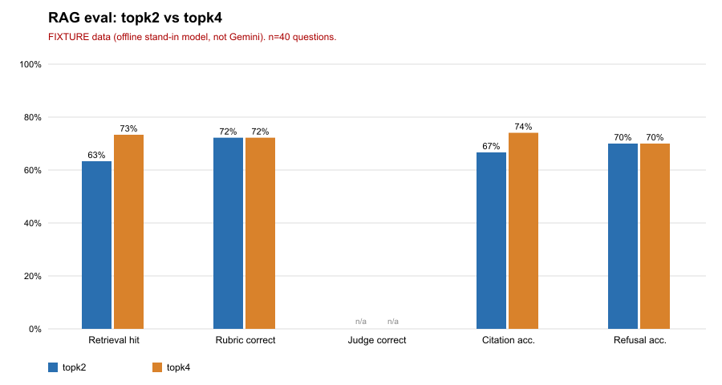

# RAG evaluation report

Generated by `npm run replay` from the saved outputs in `cache/`. Every number below is computed from those files; nothing is typed in by hand except the caveats.

## FIXTURE run (offline stand-in, not Gemini)

> FIXTURE: offline stand-in model (hashed word vectors + extractive answers). Not Gemini. Numbers say nothing about Gemini.

Configs: **topk2** (top-k 2) vs **topk4** (top-k 4). Run at 2026-11-10T01:43:58.342Z, app commit `d8d3442`.

| Metric | topk2 | topk4 |
|---|---|---|
| Retrieval hit rate (expected section in top-k, answerable only) | 63% (19/30; 95% CI 46-78%) | 73% (22/30; 95% CI 56-86%) |
| Answer correct, rubric (numbers in key fact appear; only questions whose key fact has a number) | 72% (13/18; 95% CI 49-88%) | 72% (13/18; 95% CI 49-88%) |
| Answer correct, LLM judge | not run (no model in fixture mode) | not run (no model in fixture mode) |
| Citation accuracy (among answered answerable) | 67% (18/27; 95% CI 48-81%) | 74% (20/27; 95% CI 55-87%) |
| Refusal accuracy (unanswerable should be refused) | 70% (7/10; 95% CI 40-89%) | 70% (7/10; 95% CI 40-89%) |
| False refusals (answerable but refused) | 10% (3/30; 95% CI 3-26%) | 10% (3/30; 95% CI 3-26%) |
| Latency median / p95 | 2 / 2 ms | 2 / 3 ms |
| Estimated cost for 40 questions | n/a (fixture: no paid calls) | n/a (fixture: no paid calls) |

Fixture latency is the speed of local hashing code, not of any model. Do not compare it with live latency.

### What the numbers say

- retrieval hit (answerable questions), 30 comparable questions: both right 19, only topk2 right 0, only topk4 right 3. Sign test p = 0.250 on 3 differing questions: this sample cannot separate them.
- citation accuracy (answered answerable questions), 27 comparable questions: both right 18, only topk2 right 0, only topk4 right 2. Sign test p = 0.500 on 2 differing questions: this sample cannot separate them.
- refusal accuracy (unanswerable questions), 10 comparable questions: both right 7, only topk2 right 0, only topk4 right 0. No question differs.

This fixture comparison is about retrieval only. The fixture refuses when the best passage scores below a threshold, and the best passage is the same at top-k 2 and 4, so refusal is identical by construction. Top-k only changes which passages can be cited. It says nothing about how Gemini answers.

### Misses (traceable per question)

- **topk2**: q17, q19, q23, q28, q30, q33, q35, q37, q39  (refused an answerable question, failed the rubric, or answered an unanswerable one)
- **topk4**: q17, q19, q23, q28, q30, q33, q35, q37, q39  (refused an answerable question, failed the rubric, or answered an unanswerable one)

### Hand spot-check

10 items were read one by one and compared with the automatic rubric. **The reader was an AI coding assistant, not Yazan** (AI coding assistant, not Yazan; read the saved fixture output; Yazan must redo by hand). Verdicts live in `data/spot_check.json`.

**To do by hand:** Yazan should redo these 10 checks by hand on the saved answers (and again on a live run) before anyone relies on this table. Until then it is an assistant's reading, not a human check.

| Config | Question | Hand verdict | Rubric | Note |
|---|---|---|---|---|
| topk4 | q04 | correct | pass | states 4 hours per pay period |
| topk4 | q07 | correct | pass | 15 days, matches |
| topk4 | q10 | correct | pass | 4 hours; extra sentence about 2 days is also in the handbook |
| topk4 | q13 | correct | n/a | flexible work schedules; no number so rubric cannot score it |
| topk4 | q16 | incorrect | n/a | answer is an unrelated sentence about PIV cards; never says contact the Help Desk |
| topk4 | q20 | correct | n/a | MAX.gov named; no digits so rubric cannot score it |
| topk4 | q34 | incorrect | n/a | talks about annual/sick leave, not donated leave |
| topk4 | q37 | incorrect | fail | gives the under-3-years rate (4 hours), not 8 |
| topk4 | q38 | incorrect | n/a | garbled sentence plus a generic one; does not say the PIN replaces the password |
| topk4 | q35 | incorrect | fail | does not correct the false premise that FMLA is paid |

## Live Gemini

**Not run with live key.** No saved Gemini outputs exist, so there are no live numbers. To produce them see README "Run it".

## Caveats

- **Small sample.** 40 questions, 30 answerable and 10 that should be refused. One question moves a rate by 2 to 3 points. Confidence intervals are wide; read differences smaller than about 15 points as noise.
- **Fixture numbers are not Gemini numbers.** The fixture is a word-matching stand-in. It shows the harness works, not how the real app performs.
- **The rubric is crude.** It checks numbers only, so key facts without a number (for example "yes, VLTP can be combined") get no rubric score. A wrong answer that happens to contain the right number passes.
- **The LLM judge is another model's opinion** and has not been checked against humans yet (the spot-check above covers fixture output only and was done by the assistant, not by a human). It exists only in live runs.
- **Citation accuracy** counts an answer as accurate if one cited passage is the expected section; it does not check that the cited text supports the sentence.
- **Questions were written by an AI coding assistant** (per the app's README), not by a domain expert, and the same 40 were used to tune the fixture threshold, so fixture scores are optimistic.
- **Cost** is an estimate from character counts, not billed usage.
- **Single run per config.** Live models are not deterministic; no repeats were done.

